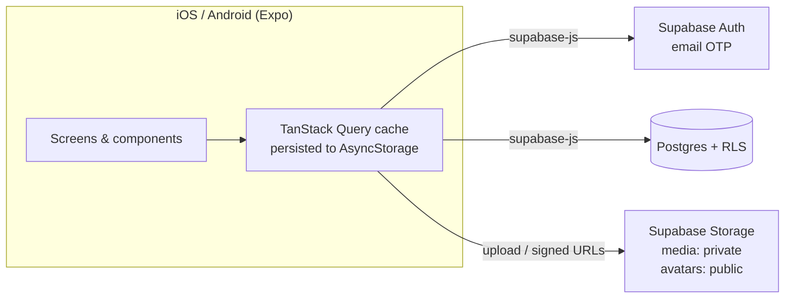

# Keeps

A social scrapbook app. A **Keep** is a collection, like a trip, a season or a friendship. Each Keep holds **posts** with photos, short videos, captions, a song and a location. A Keep can be private (only invited co-owners can see it) or public (anyone can find and follow it), and several people can co-own the same Keep.
 
> Short for keepsake: digital, living, collaborative scrapbooks.
 
Keeps allows you to document in any way that suits you. Collaboratively, individually, privately, publicly. Without distraction.
 
---
 
## Table of Contents
 
- [The Story](#the-story)
- [The Problem](#the-problem)
- [The Solution](#the-solution)
- [How Keeps Compares](#how-keeps-compares)
- [Validation](#validation)
- [Building the Prototype](#building-the-prototype)
- [Key Features](#key-features)
- [Architecture](#architecture)
- [Getting Started](#getting-started)
- [Roadmap](#roadmap)
---
 
## The Story

[DEMO]([url](https://youtube.com/shorts/Or7TCw03vtc?is=QvvBKRVAGx11QHL6)): https://youtube.com/shorts/Or7TCw03vtc?is=QvvBKRVAGx11QHL6
 
My roommate and I both studied abroad during college. We were discussing one night about the different ways we each documented that special chapter of our lives: she made a joint instagram account with her closest friends that she was abroad with, and I created a VSCO page, completely anonymous with a random username, and treated it like my own digital diary. It was like my own curated camera roll and it brought me so much joy to document in that way.
 
We reflected on how much fun it would be to physically sit down and scrapbook everything as a way to slow down and enjoy our lives and memories, but that this simply isn't realistic for our daily lives and that this exact type of activity should exist digitally, in a way that doesn't aim to suck all your time and attention away from you.
 
## The Problem
 
I ultimately had to delete my VSCO account, as it is impossible for pages to be made private, and strangers were liking my images that I felt were personal.
 
My roommate ended up deleting instagram as a whole, because it is a place for distraction or broadcasting what you want others to know about you, rather than memory archiving.
 
After this experience, I specified two main pain points that exist in the market today, and mapped out a solution that we think could fill this gap.
 
## The Solution
 
The solution is called **Keeps**, short for keepsake: digital, living, collaborative scrapbooks.
 
The idea behind Keeps is to provide a place for people who want to archive their lives without all the distractions. This is ideal for both of our use cases:
 
- **Me**, someone who just wanted a curated camera roll-type space that could be completely mine.
- **Or for my roommate** who wanted a shared archive with her friends.
## How Keeps Compares
 
This idea is kind of like **Instagram** meets **VSCO** meets **Apple Shared Albums**.
 
### Instagram
 
Instagram has turned into an ad platform and attention-suck. You might create a private account to archive, but end up accidentally doomscrolling for 4 hours a day instead. We wanted a more wholesome space for people to peacefully archive rather than bombarding their brains with an unlimited stream of content.
 
### VSCO
 
VSCO has no option for private pages, or collaborative pages, and no ability to post anything other than singular photos.
 
### Apple Shared Albums
 
Apple Shared Albums has the ability to create shared albums with comments, but it is a more sterile type of space to mass dump photos and not an app people feel welcomed to archive and curate in. There is also no ability to aggregate albums under a singular profile and no way to design pages creatively or post multimedia content (music, map pins, voice notes, etc.)
 
## Validation
 
Before moving forward, I conducted **5 interviews** amongst our social network, careful to not say what I was thinking of building, but just to gauge whether this was something that there is demand for.
 
> All 5 people I interviewed expressed extreme disdain for Instagram and liked the idea of digital scrapbooking.
 
## Building the Prototype
 
As my background is software engineering, I went on to prototype the idea and came out with an early version of our app.
 
- I tracked all the bugs in a Notion page.
- I went back and forth with my roommate to discuss features we were both thinking of, tradeoffs we need to make, what should exist in version 1 versus what we'd eventually like in version 10.
- We passed the app along to our friends and had them "roast" it.
- I iterated with the feedback.
## Key Features
 
Some of my favorite features we came up with are:
 
- **A feed that ends.** There is a feed section to see all the most recent posts, once you've seen every new post from a page you follow, then the feed ends. No unlimited scroll, just a check mark saying you're all caught up. ✅
- **Post without the pressure.** When you post, there is an option to not show on people's feed. Takes away any posting anxiety that is getting in the way of your archiving.
- **Pages, not people.** You follow pages not people.
### Two Ways to Keep
 
| Collaborative Keep | Individual Keep |
| --- | --- |
| A collaborative Keep stays alive as different people add their own memories and perspectives over time. | An individual Keep gives you a corner of the internet to make your own, peacefully and with all the necessary tools and features to color your memory in a way most meaningful to you. |
 
---

## Architecture

Keeps is a React Native app (Expo) that talks directly to Supabase. There is no custom API server. The app reads and writes Postgres through the Supabase client, and Postgres **Row Level Security (RLS)** policies decide what each user can see or change. Media files go to Supabase Storage and are displayed through short-lived signed URLs.

```
app/
  screens/      one file per screen (Feed, Profile, KeepDetail, AddPost, ...)
  components/   shared UI (KeepCoverCard, PostGridTile, LikeRow, CommentThread, ...)
  lib/          supabase client, typed queries, storage helpers, auth provider
  navigation/   AppNavigator (React Navigation native stack)
  theme/        tokens.ts, the single source of colors, type, spacing and radii
  types/        database.ts, TypeScript types that mirror the schema
supabase/       numbered SQL migrations (0001–0015), run in order
```

### System Overview



- All data access goes through typed functions in [`app/lib/queries.ts`](app/lib/queries.ts). Screens never call `supabase.from(...)` themselves.
- TanStack Query caches server state and saves it to AsyncStorage, so the app opens instantly with the last data it loaded.
- All styling comes from [`app/theme/tokens.ts`](app/theme/tokens.ts). To change the look of the app, edit the tokens and the shared components, not individual screens.

### Tech Stack

| Layer | Technology |
| --- | --- |
| Frontend | React Native 0.88 + Expo SDK 58, TypeScript, React Navigation, TanStack Query |
| Backend / API | Supabase (no custom server; the client talks to Postgres through PostgREST) |
| Database | Supabase Postgres, with access enforced by Row Level Security |
| Media Storage | Supabase Storage (`media` bucket is private with signed URLs; `avatars` bucket is public) |
| Authentication | Supabase Auth, passwordless email one-time code (OTP) |
| Hosting / Infra | Supabase (managed); app runs through Expo Go / dev builds, with EAS Build planned for TestFlight |

### Data Model

| Table | Purpose |
| --- | --- |
| `profiles` | One per user (mirrors `auth.users`): handle, display name, bio, avatar. Always publicly readable. |
| `keeps` | The core collection: title, cover photo (+ blurhash), `privacy_mode` (`private` / `public`), `is_ongoing`, `updated_at`. `owner_id` records who created it; it does not control permissions. |
| `keep_members` | The Keep's co-owners. `status` is `pending` (invited) or `approved`. `hidden_from_profile` lets each co-owner decide whether the Keep shows on their own profile. |
| `keep_followers` | Users following a Keep. Following a public Keep is instant. Following a private Keep creates a `pending` request that a co-owner must approve. |
| `profile_followers` | Following a profile. Always instant and open to anyone. |
| `posts` | An entry in a Keep: caption, song (title/artist/URL), location label, `show_in_feed`. |
| `post_media` | 1–10 photos or videos per post (`media_type`, `position`, `blurhash`), shown as a carousel. |
| `likes` | One per (post, profile). Shown as a list of names, not a count. |
| `comments` | Comments on a post. Currently flat; a `parent_id` column is reserved for threaded replies in public Keeps. |
| `favorites` | Private bookmarks on posts. Only the user who saved one can see it. |

How they relate: a profile co-owns many Keeps through `keep_members`. A Keep has many posts, and a post has many media items, likes and comments. Following happens at two levels: profiles (`profile_followers`) and Keeps (`keep_followers`).

### Privacy & Permissions

Privacy is enforced **in the database with RLS**, not only in the UI. Every policy is built from a few `security definer` helper functions: `is_keep_member`, `keep_is_public`, `has_pending_keep_invite`, `keep_is_shown_on_profile` and `is_approved_keep_follower`.

- **Private Keeps:** posts, media, likes and comments can only be read by approved co-owners and approved followers.
- **Public Keeps:** anyone can read the content. Anyone who can see a post can also like and comment on it (`0015`).
- **Hidden from profile:** each co-owner chooses whether a Keep appears on their own profile. A Keep shown on a profile appears as a locked tile (title and cover) even to strangers, but its contents stay hidden (`0010`).
- **Invite-only / collaborative:** co-ownership needs an invite that the invitee accepts. A pending invitee can see the Keep's title and cover so they can decide, but no posts until they accept (`0009`). Once approved, co-owners have **full parity**: they can post, edit settings, invite or remove co-owners, and delete the Keep.
- **Follow requests:** following a private Keep creates a request that a co-owner approves in the Follow Requests screen.
- **Moving posts:** an author can only move a post into a Keep they co-own, and its media file moves to the new Keep's storage path so storage RLS stays correct (`0008`).
- **Storage:** objects in `media` are stored at `posts/{keep_id}/...` and `covers/{keep_id}/...`. Storage policies check the `keep_id` part of the path against Keep access. Avatars live at `avatars/{profile_id}/...` and only that user can write to them.

### Feed Logic

The Feed tab ([`Feed.tsx`](app/screens/Feed.tsx), `fetchFeed` in [`queries.ts`](app/lib/queries.ts)) shows **only what's new since you last looked**, then shows "You're all caught up".

1. **Scope:** the toggle picks either **My keeps** (Keeps you're an approved co-owner of) or **All** (those plus Keeps you're an approved follower of). Pending invites and pending follow requests don't count.
2. **Filtering:** your own posts are excluded, as are posts whose author turned off **Show in feed** (`posts.show_in_feed`, `0014`). Hidden posts still appear on the Keep's own page.
3. **"Last seen" cursor:** the device stores a timestamp in AsyncStorage for each profile ([`feedSeen.ts`](app/lib/feedSeen.ts)). When the Feed opens, it loads posts newer than that timestamp and then updates the timestamp to now. Each session therefore sees a fixed set of new posts, and when there are none the screen shows "You're all caught up".
4. Posts are sorted newest first.

### Media & Multimedia

| Type | Status | How it works |
| --- | --- | --- |
| Photos | ✅ | Picked with `expo-image-picker` and optionally edited in `PhotoEditor` (`expo-image-manipulator`). A blurhash is computed on the device and saved, so tiles show a blurred preview immediately. Uploaded to the `media` bucket. |
| Video | ✅ | Up to 60 seconds and up to 10 items per post. Played with `expo-video` using native controls. |
| Music | Placeholder | Free-text song title, artist and link, shown as a card. No playback. |
| Map pins | Placeholder | Free-text location label. No map SDK. |
| Voice notes | Not built | Deferred. |

**Upload path** ([`app/lib/storage.ts`](app/lib/storage.ts)): files are sent as a `FormData` part whose `bytes()` reads the file through `expo-file-system`. Expo SDK 55+ replaces the global `fetch` with `expo/fetch`, which rejects React Native-style `{ uri, name, type }` parts and throws "Unsupported FormDataPart implementation".

**Rendering:** `post_media.media_url` stores a **storage path, not a URL**. The app requests 1-hour signed URLs, in batches for a whole Keep, and caches them in [`signedUrlCache.ts`](app/lib/signedUrlCache.ts). Images are rendered with `expo-image`.

---

## Getting Started

### Prerequisites

- **Node.js** 20+ (LTS recommended) and npm
- **Expo Go** on your phone, matching the project's Expo SDK. Alternatively, the iOS Simulator (Xcode) or Android Emulator.
- A **Supabase** project (the free tier works)

### Installation

```bash
# Clone the repo
git clone https://github.com/ellasobhani/Keeps.git
cd Keeps

# Install dependencies
npm install

# Run locally (scan the QR code with Expo Go, or press i / a for a simulator)
npx expo start
# add -c to clear the Metro cache if something acts strangely
npx expo start -c
```

### Supabase Setup

1. Create a project at [supabase.com](https://supabase.com/dashboard).
2. In the **SQL Editor**, run every file in [`supabase/`](supabase/) **in numerical order** (`0001_init.sql` → `0015_engagement_on_public_keeps.sql`). These create all tables, RLS policies, helper functions, triggers and the `media` / `avatars` storage buckets.
3. Under **Authentication → Providers**, enable Email and set up the email template to send a one-time code.
4. Copy the project URL and anon key into `.env` (see below).

> **Free-tier projects pause after about a week of inactivity.** If the app can't connect (for example, the project hostname doesn't resolve), open the dashboard and click **Restore project**.

### Environment Variables

Copy `.env.example` to `.env` and fill it in:

| Variable | Required | Description |
| --- | --- | --- |
| `EXPO_PUBLIC_SUPABASE_URL` | Yes | Your project URL, e.g. `https://xxxx.supabase.co` (Project Settings → API) |
| `EXPO_PUBLIC_SUPABASE_ANON_KEY` | Yes | The project's anon/public key. Safe to ship in the client because RLS controls access. |
| `EXPO_PUBLIC_USE_RN_FETCH` | No | Set to `1` to use React Native's original `fetch` instead of `expo/fetch`. Only needed for troubleshooting. |

`.env` is gitignored. Never commit the `service_role` key.

---

## Roadmap

### Version 1

Built so far:

- [x] Email OTP sign-in and profile setup (handle, name, bio, avatar)
- [x] Create, edit and delete Keeps with a cover photo and a private/public setting
- [x] Collaborative Keeps: invite and accept co-owners with equal rights, and per-person "show on profile"
- [x] Posts with photo/video carousels (up to 10 items, videos up to 60s), caption, song and location
- [x] Edit posts: reorder, add or remove media, move a post to another Keep
- [x] Likes (shown as names), flat comments, private favorites
- [x] Follow profiles; follow Keeps (instant for public, request and approve for private)
- [x] Feed with "My keeps / All" toggle, a per-post "show in feed" opt-out, and "all caught up"
- [x] Notifications, invites and follow-request inboxes
- [x] Search for profiles and Keeps
- [x] Blurhash placeholders and batched signed URLs for fast-loading grids


### Future (Version 10)

- Real music integration (Spotify / Apple Music link previews, then playback)
- Real map pins (Apple / Google Maps)
- Voice notes on posts
- Drag and drop posts between Keeps from the profile view
- Discovery beyond search
- Physical keepsakes (printed books from a Keep)
